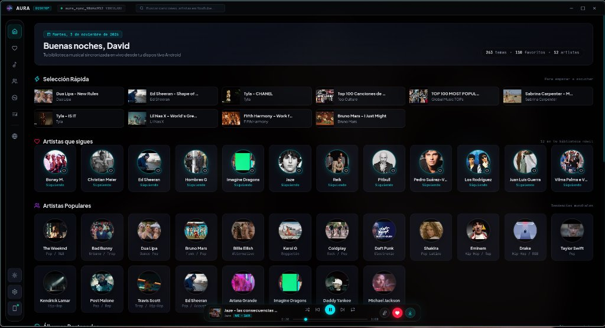
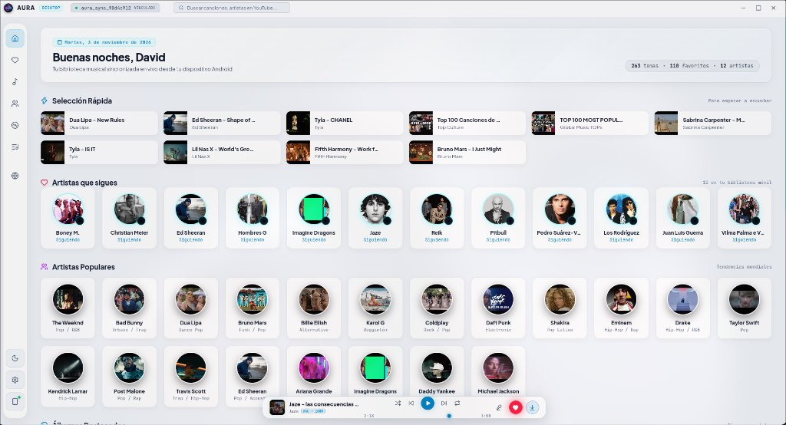
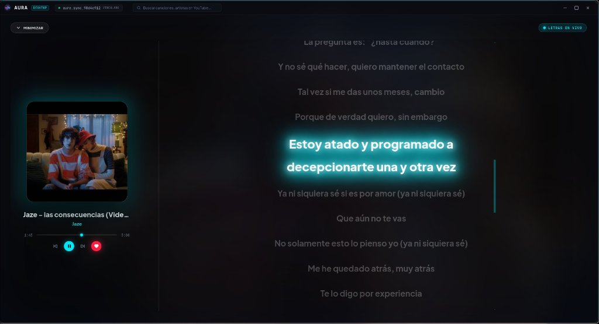

<div align="center">


# Aura Music Desktop

**Cyberpunk Audio Player & Native Mobile Sync Hub**

[](https://github.com/respaldoperez348-rgb/Aura-Music-Escritorio/releases)
[](https://github.com/respaldoperez348-rgb/Aura-Music-Escritorio/releases)
[](LICENSE)
[-818cf8.svg?style=for-the-badge&logo=firebase&logoColor=white)](https://github.com/respaldoperez348-rgb/AURA-MUSIC-ANDROID)

*Reproductor de audio de alta fidelidad para escritorio (Windows & Linux), con precarga en memoria RAM Fast-Path a 0ms, letras sincronizadas en tiempo real y vinculación instantánea bidireccional con **Aura Music Android**.*

[Descargas](#-descargas-e-instalación) • [Características](#-características-técnicas) • [Vinculación con el Móvil](#-vinculación-con-aura-music-android) • [Desarrollo](#-guía-de-desarrollo)

---

</div>

## 📸 Capturas de Pantalla

<div align="center">
  <table border="0" style="width: 100%; border-collapse: collapse;">
    <tr>
      <td align="center" width="33%">
        
        <br/><br/>
        <b>01. Interfaz Principal (Obsidian Dark)</b>
        <br/>
        <sub>Explorador de pistas, cola de reproducción y dock de sincronización.</sub>
      </td>
      <td align="center" width="33%">
        
        <br/><br/>
        <b>02. Tema Claro (Champagne Hi-Fi)</b>
        <br/>
        <sub>Modo de alto contraste para entornos iluminados de estudio.</sub>
      </td>
      <td align="center" width="33%">
        
        <br/><br/>
        <b>03. Letras Sincronizadas (LRCLIB)</b>
        <br/>
        <sub>Seguimiento dinámico línea por línea con tipografía monoespaciada.</sub>
      </td>
    </tr>
  </table>
</div>

---

## ⚡ Características Técnicas

- **Fast-Path 0ms RAM Buffer**: Precarga en segundo plano los siguientes 3 streams de audio en la memoria del sistema para transiciones instantáneas sin buffering.
- **Push-to-Phone Sync**: Arquitectura híbrida que sincroniza colas, listas y estados de reproducción entre tu PC y tu teléfono Android mediante **Firebase Cloud Messaging** y un servidor HTTP local en puerto `8765`.
- **Motor Híbrido de Audio**: Extracción de audio con binario nativo optimizado `yt-dlp` y fallback automático a `@distube/ytdl-core`.
- **Letras Sincronizadas Dinámicas**: Integración con el proveedor abierto **LRCLIB** con scroll suave y resaltado en vivo.
- **100% Libre y Privado**: Cero telemetría invasiva, cero analíticas comerciales y código completamente auditable.

---

## 📦 Descargas e Instalación

Puedes descargar las versiones compiladas directamente desde [GitHub Releases](https://github.com/respaldoperez348-rgb/Aura-Music-Escritorio/releases).

### 🪟 Windows (10 / 11)
- **Instalador Oficial (`.exe`)**: `Aura Music Setup 1.0.0.exe` (incluye extractor de audio integrado).
- **Versión Portable (`.zip`)**: `Aura Music-1.0.0-win.zip` (descomprimir y ejecutar directamente sin instalación).

### 🐧 Linux (Todas las distribuciones)
- **AppImage Universal**:
  ```bash
  chmod +x "Aura Music-1.0.0.AppImage"
  ./"Aura Music-1.0.0.AppImage"
  ```
- **Paquete Debian / Ubuntu (`.deb`)**:
  ```bash
  sudo dpkg -i aura-music-desktop_1.0.0_amd64.deb
  sudo apt-get install -f
  ```

---

## 📲 Vinculación con Aura Music Android

Para controlar la reproducción de tu teléfono desde el teclado de tu PC o enviar pistas del escritorio a tu móvil:

1. Abre **Aura Music** en tu Android y dirígete a **Ajustes → Conexión de Escritorio**.
2. Copia tu código único de vinculación (ej. `aura_sync_a1b2c3d4`).
3. En la barra superior de Aura Music Desktop, haz clic en el botón de estado de sincronización (la píldora superior).
4. Pega tu código y presiona **Conectar y Sincronizar**.

> **Nota de Seguridad sobre Firebase**: Para comunicarse con Firestore, la aplicación utiliza las credenciales del proyecto `aura-music-90931`. En entornos de producción local, puedes colocar el archivo `service-account.json` en la carpeta de datos de la app (`%APPDATA%\Aura Music\` en Windows o `~/.config/Aura Music/` en Linux), o definir la variable de entorno `AURA_SERVICE_ACCOUNT=/ruta/service-account.json`. Nunca subas dicho archivo a repositorios públicos.

---

## 🛠️ Guía de Desarrollo

### Requisitos previos
- [Node.js](https://nodejs.org/) v20 o superior
- [npm](https://www.npmjs.com/) v10 o superior

### Instalación y ejecución
```bash
# Clonar el repositorio
git clone git@github.com:respaldoperez348-rgb/Aura-Music-Escritorio.git
cd Aura-Music-Escritorio

# Instalar dependencias
npm install

# Iniciar en modo desarrollo
npm start
```

### Compilación de paquetes de producción
```bash
# Compilar instalador para Windows (NSIS & Portable)
npm run dist:win

# Compilar paquetes para Linux (AppImage & DEB)
npm run dist:linux
```

---

## 👤 Autor & Créditos

- **Desarrollador Principal**: **Manuel David Tineo** ([@respaldoperez348-rgb](https://github.com/respaldoperez348-rgb))
- **Proyecto Móvil Relacionado**: [AURA-MUSIC-ANDROID](https://github.com/respaldoperez348-rgb/AURA-MUSIC-ANDROID)
- **Comunidad**: [Servidor de Discord](https://discord.gg/2fPm9WvF) • [Canal de Telegram](https://t.me/AuraMusicOficial2)

---

## 📄 Licencia

Distribuido bajo la Licencia **MIT**. Consulta el archivo `LICENSE` para más información.
